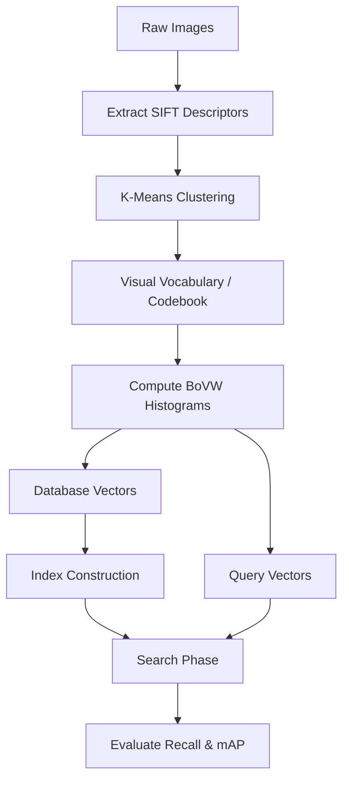
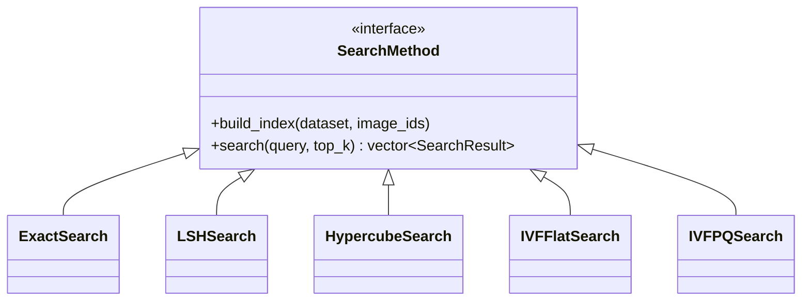

# Implementation Breakdown and Logic Guide

## 1. High-Level Architecture Overview

This project implements an end-to-end Image Search system based on the Bag of Visual Words (BoVW) model, scaled with advanced Approximate Nearest Neighbor (ANN) algorithms.

The overall lifecycle of the application follows a robust pipeline:
1. **Feature Extraction:** SIFT descriptors are extracted from images using OpenCV.
2. **Vocabulary Building:** A subset of these descriptors is clustered using Lloyd's K-Means algorithm to form a visual vocabulary (codebook).
3. **Histogram Generation:** Images are converted into fixed-size dimensional vectors (histograms) by assigning their SIFT descriptors to the nearest visual words.
4. **Indexing & Searching:** The database vectors are indexed into specialized data structures, which are subsequently queried using specific search methodologies to retrieve similar images.



## 2. Core Architectural & Logical Decisions

### Object-Oriented Design (Polymorphism)
To manage multiple search algorithms cleanly, the codebase heavily utilizes Object-Oriented Programming principles. The `SearchMethod` abstract base class defines a standard interface (`build_index` and `search`). This allows the main evaluation pipeline in `evaluate_queries` to remain entirely agnostic to the underlying algorithm being used, enforcing clean separation of concerns and dependency inversion.

### Performance Optimization: Delaying Expensive Math
A significant decision for computational efficiency was the consistent use of squared Euclidean distance (`squared_distance`) throughout the pipeline. The expensive `std::sqrt` operation is strictly avoided during inner-loop comparisons (like k-means assignments, LSH hashing, or IVF distance table computation). The actual square root is only applied at the very end of a search when constructing the final `SearchResult` objects for the user.

## 3. Focused Breakdown of Major Components

### 3.1. K-Means & The Pipeline (`kmeans.cpp`, `pipeline.cpp`)
- **`kmeans`:** Implements Lloyd's algorithm. It handles edge cases (like empty clusters) by dynamically re-initializing centroids to random points from the dataset, ensuring the vocabulary doesn't collapse.
- **`compute_dataset_bovw`:** Converts lists of raw images into dense frequency histograms utilizing the generated vocabulary.

### 3.2. Search Algorithms



#### Exact Search (`ExactSearch`)
Provides a ground-truth baseline by exhaustively computing the distance between the query and every vector in the dataset. It leverages `std::sort` to rank and retrieve the top K results.

#### Locality Sensitive Hashing (`LSHSearch`)
- **Theory to C++:** Vectors are hashed using random projections. The continuous vector space is quantized into discrete buckets using the formula $h = \lfloor(v \cdot p + t) / w\rfloor$.
- **Implementation:** Uses multiple hash tables ($L$) with $k$ projections each. To handle variable-length multidimensional hashes, the scalar projections are concatenated into strings (e.g., `"4_-2_5_"`) and used as keys in `std::unordered_map` arrays. The buckets store vectors of dataset indices to keep memory usage low.

#### Random Projection Hypercube (`HypercubeSearch`)
- **Theory to C++:** Embeds continuous points into the vertices of a $d$-dimensional boolean hypercube using random hyperplanes and binary assignments.
- **Highlight - Gosper's Hack:** To find nearest neighbors across the hypercube, the algorithm must probe vertices in increasing order of Hamming distance from the query's mapped vertex. Instead of iterating through all $2^d$ vertices and calculating their Hamming distance manually, the C++ implementation uses **Gosper's Hack** to iteratively generate only the bitmasks with exactly `dist` bits set in $O(1)$ time per mask.

```cpp
// Generating bitmasks with exactly 'dist' bits set (Gosper's hack)
uint64_t mask = (dist == 0) ? 0 : (1ULL << dist) - 1;
while (visited < probes_ && checked < M_ && mask < (1ULL << kproj_)) {
    // ... Probe the bucket using: (query_vertex ^ mask) ...

    // Generate next permutation of bits
    if (mask == 0) break;
    uint64_t c = mask & -mask;
    uint64_t r = mask + c;
    mask = (((r ^ mask) >> 2) / c) | r;
}
```

#### Inverted File Index & Product Quantization (`IVFFlatSearch`, `IVFPQSearch`)
- **Theory to C++:** Divides the dataset into Voronoi cells via coarse quantization (k-means) to drastically narrow down the exhaustive search space.
- **Highlight - Memory and Inverted List Handling:**
  Inverted lists are implemented efficiently using `std::vector<std::vector<int>> inverted_lists_`. The outer vector represents the coarse cluster ID, and the inner vector holds integer dataset indices. This structure ensures cache-friendly, contiguous memory access when sequentially scanning a cluster's points.

  In `IVFPQSearch`, memory footprint is exponentially reduced. Instead of storing 128-float residuals for every indexed point, the residual is split into $M$ orthogonal segments. Each segment is quantized into a small 8-bit integer (PQ Code).

  During the search phase, asymmetric distance computation (ADC) is utilized. A small distance table is computed *once* per query for the probed clusters. This allows the inner loop to calculate distances using simple, lightning-fast table lookups rather than floating-point math:

```cpp
// Inner loop: Fast asymmetric distance computation via table lookup
for (int i : inverted_lists_[c]) {
    float dist_sq = 0;
    // Iterate over M segments and lookup precomputed distances using the PQ code
    for (int m = 0; m < M_; ++m) {
        dist_sq += dist_table[m][pq_codes_[i][m]];
    }
    results.push_back({image_ids_[i], sqrt(dist_sq)});
}
```