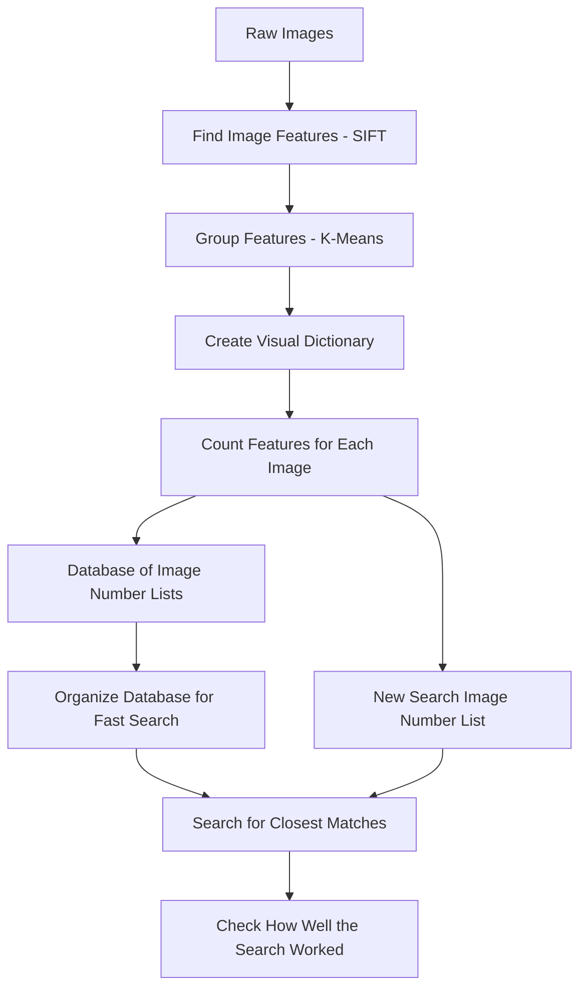
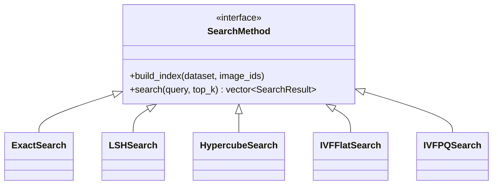

# Implementation Breakdown and Logic Guide

## 1. High-Level Architecture Overview

Welcome! This project is an Image Search system. Imagine you have a massive photo album, and you want to find all pictures that look similar to a new photo you just took. To do this quickly, our system doesn't look at the whole picture at once; instead, it looks for special "features" or patterns.

Here is the step-by-step journey of how our system works:

1. **Finding Features (Feature Extraction):** First, we use a tool called OpenCV to find tiny, interesting details in every image (like corners or edges). These are called SIFT descriptors.
2. **Creating a Visual Dictionary (Vocabulary Building):** We take a bunch of these tiny details from many images and group similar ones together using a grouping method called K-Means. This creates a "dictionary" of common visual patterns.
3. **Building Histograms (Histogram Generation):** For each image, we count how many times each pattern from our dictionary appears. We turn this count into a list of numbers (a vector or histogram). Now, every image is just a list of numbers!
4. **Storing and Searching (Indexing & Searching):** We store all these lists of numbers in a smart way so we can search through them quickly. When you want to search for a new image, we turn it into a list of numbers too, and find the closest matches in our database.



## 2. Core Architectural & Logical Decisions

### Using Object-Oriented Design (Polymorphism)
We wanted to try several different ways to search for images. To keep the code neat and organized, we used an Object-Oriented Programming (OOP) trick. We created a blueprint called `SearchMethod`. Every specific search strategy (like Exact Search or LSH Search) follows this blueprint. This means the rest of our program doesn't need to care *how* the search is done, it just says "build the index" and "search!" This keeps our code very clean.

### Speed Trick: Avoiding Slow Math
When finding the "closest" image, we measure the distance between their lists of numbers using a math formula called Euclidean distance. This formula normally requires calculating a square root, which is surprisingly slow for a computer to do millions of times.
To speed things up, we compare the *squared* distances instead. We only do the slow square root math right at the very end when we show the final results to the user.

## 3. In-Depth Breakdown of Major Components

### 3.1. Creating the Groups (`kmeans.cpp`, `pipeline.cpp`)
- **`kmeans`:** This function is a grouping algorithm. Imagine scattering a bunch of dots on a table and trying to find the center of where the dots clump together. This algorithm guesses the centers, assigns dots to the closest center, and then adjusts the center until it perfectly matches the clumps. If a center accidentally gets no dots, we give it a new random starting point so it doesn't break.
- **`compute_dataset_bovw`:** This takes raw images and translates them into our "lists of numbers" (histograms) by comparing the image's features to the visual dictionary we just made.

### 3.2. Search Algorithms



#### Exact Search (`ExactSearch`)
This is the simplest but slowest method.
**How it works:** It takes your search image and compares it to *every single image* in the database, one by one. It measures the distance to each one, sorts them all from closest to furthest, and gives you the top matches. It's perfectly accurate but takes a long time if you have millions of images.

#### Locality Sensitive Hashing (`LSHSearch`)
This method speeds things up by putting similar images into the same "buckets".
**How it works:** Imagine drawing random lines through all your data points. Depending on which side of the line a point falls, it gets a score. We combine these scores into a label (like `"4_-2_5_"`). Images that are similar will likely get the same label and end up in the same bucket. When searching, we only look inside the buckets that match our search image's label, ignoring the rest of the database!
**C++ Detail:** We use `std::unordered_map` to build these buckets because it lets the computer instantly jump to the right bucket without searching.

#### Random Projection Hypercube (`HypercubeSearch`)
This is a very advanced way to organize data into a geometric shape called a hypercube.
**How it works:** It turns each image's list of numbers into a simple binary code (like `10110`). Think of this code as a specific corner on a multi-dimensional cube. When searching, we look at the corner for our search image. If we don't find enough matches there, we look at the neighboring corners (corners where only one bit is different, like `10111`).
**Code Highlight - Gosper's Hack:** To find these neighboring corners efficiently, we need to flip bits in a very specific order based on how many bits are different (Hamming distance). Instead of checking every possible corner, our code uses a famous, super-fast math trick called **Gosper's Hack**. It instantly generates the exact bit patterns we need to check next.

```cpp
// Generating bit patterns to check neighboring corners (Gosper's hack)
uint64_t mask = (dist == 0) ? 0 : (1ULL << dist) - 1;
while (visited < probes_ && checked < M_ && mask < (1ULL << kproj_)) {
    // ... Check the neighboring corner ...

    // Gosper's Hack: Generate the next bit pattern instantly
    if (mask == 0) break;
    uint64_t c = mask & -mask;
    uint64_t r = mask + c;
    mask = (((r ^ mask) >> 2) / c) | r;
}
```

#### Inverted File Index & Product Quantization (`IVFFlatSearch`, `IVFPQSearch`)
These methods organize the database like a filing cabinet to make searching incredibly fast, even for huge datasets.
**How IVFFlat works:** It uses K-Means to divide the whole database into big regions. When searching, it figures out which region the search image belongs to, and then *only* searches inside that specific region.
**How IVFPQ works:** This makes IVFFlat even better by saving memory. Instead of saving the full, long list of numbers for every image, it breaks the list into smaller chunks and rounds them off to a tiny code (Product Quantization).

**Code Highlight - Fast Table Lookups:**
Because we squished the data into tiny codes, we can do something amazing during the search. Instead of doing complicated math to measure distances for every image, we create a small "cheat sheet" (distance table) for the search image *once*. Then, for every image in the region, we just look up the answer in our cheat sheet! This is lightning fast.

```cpp
// Inner loop: Lightning-fast distance calculation using our "cheat sheet" table
for (int i : inverted_lists_[c]) {
    float dist_sq = 0;
    // Iterate over the small chunks of our data
    for (int m = 0; m < M_; ++m) {
        // Look up the pre-calculated distance in the table instead of doing math!
        dist_sq += dist_table[m][pq_codes_[i][m]];
    }
    results.push_back({image_ids_[i], sqrt(dist_sq)});
}
```