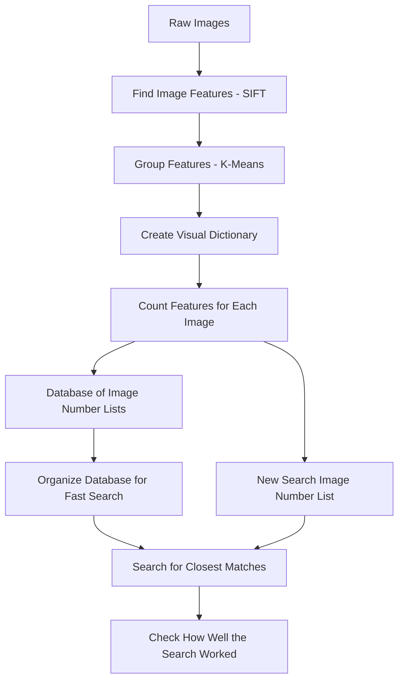
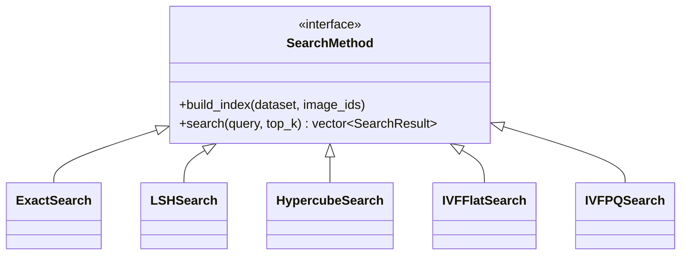

# Implementation Breakdown and Logic Guide

## 1. High-Level Architecture Overview

Welcome! This project is an Image Search system. Imagine you have a massive photo album, and you want to find all pictures that look similar to a new photo you just took. To do this quickly, our system doesn't look at the whole picture at once; instead, it looks for special "features" or patterns.

Here is the step-by-step journey of how our system works:

1. **Finding Features (Feature Extraction):** First, we use a tool called OpenCV to find tiny, interesting details in every image (like corners or edges). These are called SIFT descriptors.
2. **Creating a Visual Dictionary (Vocabulary Building):** We take a bunch of these tiny details from many images and group similar ones together using a grouping method called K-Means. This creates a "dictionary" of common visual patterns.
3. **Building Histograms (Histogram Generation):** For each image, we count how many times each pattern from our dictionary appears. We turn this count into a list of numbers (a vector or histogram). Now, every image is just a list of numbers!
4. **Storing and Searching (Indexing & Searching):** We store all these lists of numbers in a smart way so we can search through them quickly. When you want to search for a new image, we turn it into a list of numbers too, and find the closest matches in our database.



## 2. Core Architectural & Logical Decisions

### Object-Oriented Design (Polymorphism)
To manage multiple search algorithms cleanly, the codebase heavily utilizes Object-Oriented Programming principles. The `SearchMethod` abstract base class defines a standard interface (`build_index` and `search`). This allows the main evaluation pipeline in `evaluate_queries` to remain entirely agnostic to the underlying algorithm being used, enforcing clean separation of concerns and dependency inversion.

### Performance Optimization: Delaying Expensive Math
A significant decision for computational efficiency was the consistent use of squared Euclidean distance (`squared_distance`) throughout the pipeline. The expensive `std::sqrt` operation is strictly avoided during inner-loop comparisons (like k-means assignments, LSH hashing, or IVF distance table computation). The actual square root is only applied at the very end of a search when constructing the final `SearchResult` objects for the user.

## 3. Focused Breakdown of Major Components

### 3.1. K-Means & The Pipeline (`kmeans.cpp`, `pipeline.cpp`)
- **`kmeans`:** Implements Lloyd's algorithm. It handles edge cases (like empty clusters) by dynamically re-initializing centroids to random points from the dataset, ensuring the vocabulary doesn't collapse.
- **`compute_dataset_bovw`:** Converts lists of raw images into dense frequency histograms utilizing the generated vocabulary.

### 3.2. Search Algorithms



#### Exact Search (`ExactSearch`)
Provides a ground-truth baseline by exhaustively computing the distance between the query and every vector in the dataset. It leverages `std::sort` to rank and retrieve the top K results.

#### Locality Sensitive Hashing (`LSHSearch`)
- **Theory to C++:** Vectors are hashed using random projections. The continuous vector space is quantized into discrete buckets using the formula $h = \lfloor(v \cdot p + t) / w\rfloor$.
- **Implementation:** Uses multiple hash tables ($L$) with $k$ projections each. To handle variable-length multidimensional hashes, the scalar projections are concatenated into strings (e.g., `"4_-2_5_"`) and used as keys in `std::unordered_map` arrays. The buckets store vectors of dataset indices to keep memory usage low.

#### Random Projection Hypercube (`HypercubeSearch`)
- **Theory to C++:** Embeds continuous points into the vertices of a $d$-dimensional boolean hypercube using random hyperplanes and binary assignments.
- **Highlight - Gosper's Hack:** To find nearest neighbors across the hypercube, the algorithm must probe vertices in increasing order of Hamming distance from the query's mapped vertex. Instead of iterating through all $2^d$ vertices and calculating their Hamming distance manually, the C++ implementation uses **Gosper's Hack** to iteratively generate only the bitmasks with exactly `dist` bits set in $O(1)$ time per mask.

```cpp
// Generating bitmasks with exactly 'dist' bits set (Gosper's hack)
uint64_t mask = (dist == 0) ? 0 : (1ULL << dist) - 1;
while (visited < probes_ && checked < M_ && mask < (1ULL << kproj_)) {
    // ... Probe the bucket using: (query_vertex ^ mask) ...

    // Generate next permutation of bits
    if (mask == 0) break;
    uint64_t c = mask & -mask;
    uint64_t r = mask + c;
    mask = (((r ^ mask) >> 2) / c) | r;
}
```

#### Inverted File Index & Product Quantization (`IVFFlatSearch`, `IVFPQSearch`)
These methods organize the database like a filing cabinet to make searching incredibly fast, even for huge datasets.
**How IVFFlat works:** It uses K-Means to divide the whole database into big regions. When searching, it figures out which region the search image belongs to, and then *only* searches inside that specific region.
**How IVFPQ works:** This makes IVFFlat even better by saving memory. Instead of saving the full, long list of numbers for every image, it breaks the list into smaller chunks and rounds them off to a tiny code (Product Quantization).

**Code Highlight - Fast Table Lookups:**
Because we squished the data into tiny codes, we can do something amazing during the search. Instead of doing complicated math to measure distances for every image, we create a small "cheat sheet" (distance table) for the search image *once*. Then, for every image in the region, we just look up the answer in our cheat sheet! This is lightning fast.

```cpp
// Inner loop: Lightning-fast distance calculation using our "cheat sheet" table
for (int i : inverted_lists_[c]) {
    float dist_sq = 0;
    // Iterate over the small chunks of our data
    for (int m = 0; m < M_; ++m) {
        // Look up the pre-calculated distance in the table instead of doing math!
        dist_sq += dist_table[m][pq_codes_[i][m]];
    }
    results.push_back({image_ids_[i], sqrt(dist_sq)});
}
```