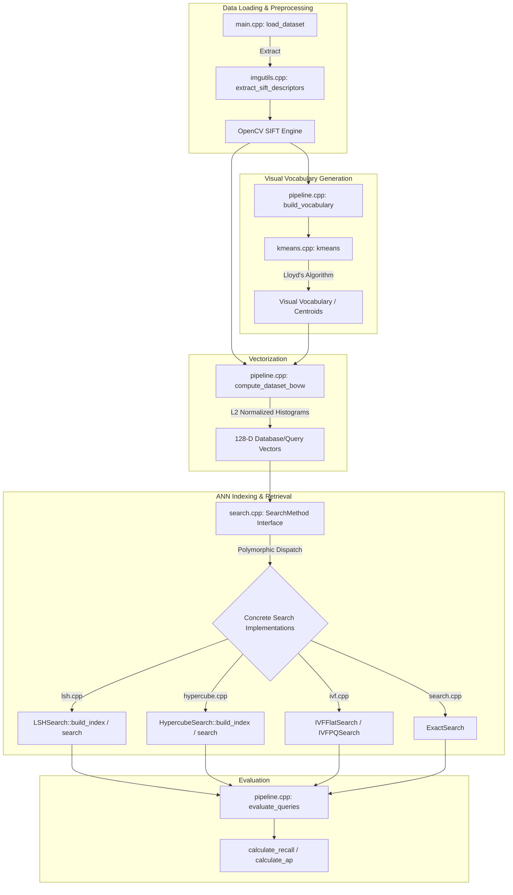

# Advanced Implementation Breakdown and Logic Guide

## 1. High-Level Architecture Overview

This project implements a highly optimized, end-to-end Image Search pipeline based on the Bag of Visual Words (BoVW) paradigm, accelerated by state-of-the-art Approximate Nearest Neighbor (ANN) indexing structures.

The architecture strictly adheres to a modular Object-Oriented design, utilizing polymorphism to decouple the core search logic from the dataset evaluation pipeline.

### Advanced System Flow



## 2. In-Depth Component Analysis & Implementation Details

### 2.1. Feature Pipeline (`pipeline.cpp`)

**Theory:** The Bag of Visual Words model maps varying numbers of local image features (e.g., SIFT descriptors) into a fixed-dimensional global representation. By extracting invariant scale and rotation features, clustering them into a discrete vocabulary $K$, and generating normalized frequency histograms, we project images into a metric space suitable for $L_2$ distance-based retrieval.

**Implementation Details:**
The pipeline manages the orchestration of data flow. SIFT descriptors are extracted via OpenCV and pooled across the training set to construct the vocabulary. Crucially, query images are not artificially capped on feature extraction, ensuring maximum signal fidelity during retrieval.

```cpp
// src/pipeline.cpp (Line ~27): Computing BoVW Histograms
vector<vector<float>> compute_dataset_bovw(const vector<Image>& images, const vector<vector<float>>& vocabulary, int max_features) {
    vector<vector<float>> bovw_dataset;
    for (const auto& image : images) {
        // High feature cap for queries to prevent signal loss
        vector<vector<float>> descriptors = extract_sift_descriptors(image.path, max_features);
        vector<float> histogram = compute_bovw_histogram(descriptors, vocabulary);
        bovw_dataset.push_back(histogram);
    }
    return bovw_dataset;
}
```

### 2.2. Vocabulary Clustering (`kmeans.cpp`)

**Theory:** Lloyd's algorithm for K-Means aims to partition $N$ observations into $K$ sets by minimizing the within-cluster sum of squares (WCSS). It is an iterative expectation-maximization (EM) process. The algorithm assigns points to the nearest centroid (Expectation) and updates centroids to the mean of assigned points (Maximization) until convergence.

**Implementation Details:**
The C++ implementation utilizes standard `<random>` engines for uniform initializations. A critical edge case handled here is "empty clusters." If a centroid fails to capture any points during the assignment phase, its coordinate vector collapses, rendering it defunct. The implementation mitigates this by re-initializing degenerate centroids to random dataset coordinates drawn via `std::mt19937`.

```cpp
// src/kmeans.cpp (Line ~37): Assignment Phase (Expectation)
float dist = squared_distance(points[i], centroids[j]);
if(dist < min_dist) {
    min_dist = dist;
    closest_centroid = j;
}

// src/kmeans.cpp (Line ~53): Centroid Update & Degeneracy Handling (Maximization)
for (int j = 0; j < k; ++j) {
    if (count_centroids[j] > 0) {
        for (size_t d = 0; d < centroids[j].size(); ++d) {
            centroids[j][d] = sum_centroids[j][d] / count_centroids[j];
        }
    } else {
        // Re-initialize empty clusters to a random point to prevent vocabulary collapse
        centroids[j] = points[dis(gen)];
    }
}
```

### 2.3. Exact Search & Evaluation Metrics (`search.cpp`)

**Theory:** Exact search acts as the ground-truth baseline, executing an exhaustive nearest neighbor search in $O(N \cdot D)$ time complexity, where $N$ is the dataset size and $D$ is the dimensionality. Retrieval performance is quantified using Recall@K (fraction of relevant images retrieved in top K) and Average Precision (AP), which is rank-sensitive.

**Implementation Details:**
To optimize the inner loop of the exhaustive search, the expensive `std::sqrt` is delayed. Distances are computed and compared strictly in the squared $L_2$ domain (`squared_distance`). `std::sort` is leveraged to rank the distances.

```cpp
// src/search.cpp (Line ~22): Exhaustive Brute-Force Search
vector<SearchResult> ExactSearch::search(const vector<float>& query, int top_k) {
    vector<SearchResult> results;
    for (size_t i = 0; i < dataset_.size(); ++i) {
        // std::sqrt only executed after squared distance computation for minor overhead reduction (Line 26)
        float distance = sqrt(squared_distance(query, dataset_[i]));
        results.push_back({image_ids_[i], distance});
    }
    sort(results.begin(), results.end(), [](const SearchResult& a, const SearchResult& b) {
        return a.distance < b.distance;
    });
    results.resize(min(top_k, static_cast<int>(results.size())));
    return results;
}
```

### 2.4. Locality Sensitive Hashing (`lsh.cpp`)

**Theory:** Locality Sensitive Hashing (LSH) projects data into lower-dimensional sub-spaces using randomized hash functions designed such that vectors in close proximity have a high probability of colliding into the same hash bucket. The hash functions use random Gaussian projections and uniform scalar shifts: $h_{\mathbf{v}, t}(\mathbf{x}) = \lfloor \frac{\mathbf{v} \cdot \mathbf{x} + t}{w} \rfloor$.

**Implementation Details:**
Multiple hash tables ($L$) with $k$ amplified projections are constructed. The multidimensional scalar projections are serialized into a unique string key (`"h1_h2_h3_"`) for deterministic $O(1)$ lookups in a `std::unordered_map`.

```cpp
// src/lsh.cpp (Line ~9): Hashing Mechanism
string LSHSearch::hash(const vector<float>& point, int table_index) const {
    string combined_hash = "";
    for (int j = 0; j < k_; ++j) {
        float dot_product = 0.0f;
        const auto& proj = hash_tables_[table_index][j];
        for (size_t d = 0; d < point.size(); ++d) {
            dot_product += point[d] * proj[d];
        }
        float t = proj.back();
        // Discretization scalar
        int h = static_cast<int>(floor((dot_product + t) / w_));
        combined_hash += to_string(h) + "_";
    }
    return combined_hash;
}

// src/lsh.cpp (Line ~68): O(1) Bucket Retrieval
auto it = buckets_[l].find(h);
if (it != buckets_[l].end()) {
    candidate_indices.insert(it->second.begin(), it->second.end());
}
```

### 2.5. Random Projection Hypercube (`hypercube.cpp`)

**Theory:** This algorithm embeds $D$-dimensional real-valued vectors into the vertices of a $d$-dimensional boolean hypercube (where $d \in \{1, ..., 63\}$). Random hyperplanes partition the space; points on one side receive a '1' bit, the other a '0'. Querying involves mapping the query to a vertex and executing a breadth-first exploration of vertices in increasing Hamming distance.

**Implementation Details:**
The C++ implementation utilizes a `uint64_t` bitmask representation. To traverse the hypercube efficiently without enumerating $2^d$ vertices, the implementation employs **Gosper's Hack**, a bit-manipulation algorithm that generates lexicographically ordered permutations of bitmasks with exactly $N$ bits set in $O(1)$ time per mask.

```cpp
// src/hypercube.cpp (Line ~61): Hamming Distance Exploration via Gosper's Hack
for (int dist = 0; dist <= kproj_ && visited < probes_ && checked < M_; ++dist) {
    // Generate initial bitmask with exactly 'dist' bits set
    uint64_t mask = (dist == 0) ? 0 : (1ULL << dist) - 1;
    while (visited < probes_ && checked < M_ && mask < (1ULL << kproj_)) {
        ++visited;
        auto it = buckets_.find(q ^ mask); // XOR to probe neighboring vertex
        // ... Retrieve candidates ...

        if (mask == 0) break;
        // Gosper's Hack (Line 72): Generate next lexicographical bitmask permutation in O(1)
        uint64_t c = mask & -mask, r = mask + c;
        mask = (((r ^ mask) >> 2) / c) | r;
    }
}
```

### 2.6. Inverted File Index & Product Quantization (`ivf.cpp`)

**Theory (IVFFlat):** The Inverted File Index (IVF) utilizes coarse quantization to partition the dataset into Voronoi cells. During search, the query vector is assigned to the nearest $N_{probe}$ centroids, and only the subsets (inverted lists) associated with those centroids are scanned exhaustively, achieving sub-linear time retrieval.

**Theory (IVFPQ):** Product Quantization (PQ) is a lossy compression technique applied on top of IVF to minimize memory bandwidth bottlenecks. The high-dimensional residual vector $\mathbf{r} = \mathbf{x} - \mathbf{q}_c(\mathbf{x})$ is split into $M$ orthogonal subspaces. Each subspace is independently quantized into a sub-codebook of size $k^*$. A vector is represented simply by $M$ integer indices.

**Implementation Details:**
For IVFPQ, the C++ implementation capitalizes on Asymmetric Distance Computation (ADC). Instead of reconstructing the compressed vector for $L_2$ evaluation, a look-up table (`dist_table`) containing the squared distances between the query residual's subspaces and all sub-centroids is precomputed *once*. The inner loop executes only scalar additions of precomputed distances via array index lookups, entirely eliminating floating-point multiplications in the critical path.

```cpp
// src/ivf.cpp (Line ~166): Distance Table Precomputation
for (int m = 0; m < M_; ++m) {
    // segment initialized from query_residual
    for (int k = 0; k < k_sub_; ++k) {
        dist_table[m][k] = squared_distance(segment, sub_centroids_[m][k]);
    }
}

// src/ivf.cpp (Line ~172): Asymmetric Distance Computation Inner Loop
for (int i : inverted_lists_[c]) { // Iterate over cluster's points
    float dist_sq = 0;
    // Iterate over M orthogonal sub-spaces
    for (int m = 0; m < M_; ++m) {
        // O(1) Cache-friendly lookup using the 8-bit PQ code
        dist_sq += dist_table[m][pq_codes_[i][m]];
    }
    results.push_back({image_ids_[i], sqrt(dist_sq)});
}
```

## 3. Advanced Oral Exam Preparation & Critical Analysis

### Architecture & Conceptual Design
**Q: Explain the exact mechanism by which IVFPQ achieves a lower computational bound than IVFFlat during the search phase.**
**A:** IVFFlat requires computing the $L_2$ norm across all 128 dimensions for every candidate vector residing in the probed inverted lists, resulting in 128 floating-point multiplications per comparison. Conversely, IVFPQ leverages Asymmetric Distance Computation (ADC). It computes a $M \times k_{sub}$ distance table *once* per probed coarse centroid. During the inner loop traversal, evaluating the distance to an indexed vector requires exactly $M$ scalar additions (table lookups) and zero floating-point multiplications, reducing the computational complexity of the inner loop from $O(D)$ to $O(M)$, while simultaneously reducing the cache-miss penalty due to the memory compression ratio of $\frac{D \cdot \text{sizeof(float)}}{M \cdot \text{sizeof(int8)}}$.

### Computer Vision Theory (Critical Thinking)
**Q: Consider an evaluation querying dataset containing three variations of an image: 1) A keyboard isolated on a white background, 2) A keyboard situated on a highly cluttered desk, 3) The cluttered desk without the keyboard. When evaluating retrieval performance (mAP) utilizing the BoVW + SIFT model, which variation provides the most robust query signal and why?**
**A:** Variation 1 provides the superior query signal. SIFT (Scale-Invariant Feature Transform) detects robust local extrema in the scale-space difference of Gaussians. In Variation 2, a significant proportion of the extracted SIFT keypoints will originate from the high-frequency textural variance of the cluttered desk (the background noise). When quantized and pooled into a normalized BoVW histogram, the frequency bins representing the core keyboard features are diluted by the background noise bins. Variation 1 isolates the object features, ensuring the resultant vector maintains a high signal-to-noise ratio in the feature space, leading to a mathematically closer cosine/Euclidean alignment with isolated keyboard images in the dataset manifold.